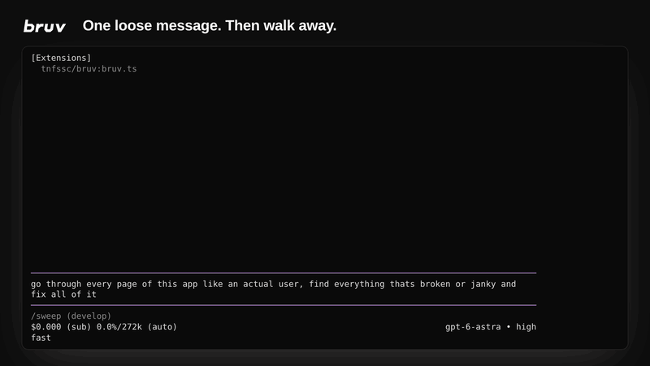

# bruv



**It finishes.** GPT runs don't stop halfway. A fresh agent checks the work against what you
asked, and you get a receipt showing what it tried and anything still missing.

A reply halfway through no longer ends the run: the model writes its answer and calls `finish`.
When files changed, a fresh check tries the result before accepting done. Plain answers skip the check.

Give it a goal, let agents work in parallel, and come back to results—not another request to continue.
bruv runs inside [Pi](https://pi.dev), an alternative to the Codex CLI, not a plugin for it.

- **Keep working without “continue.”** GPT runs keep going by default. `/keep-going on|off|auto` changes this; `/goal` adds an objective, criteria and an optional token budget.
- **See what was checked.** The terminal receipt lists the request, checks, remaining gaps, changed files, time and usage. `/check on|off` controls the fresh check.
- **Don't wait on one thing at a time.** Run tests in the background while agents investigate bugs or build separate parts in their own copies of your repo.
- **Keep what the team learns.** bruv reads and writes the project's notes in `.agents/notes/`: choices, reasons, what was tried. They're shared through git, and the next session starts from them.
- **Do more per turn.** The model can read files, make edits, and run checks in one script, filtering long logs before they fill the conversation.

## Get started

One command installs [Pi](https://pi.dev) if you don't have it, then adds bruv:

```sh
curl -fsSL https://bruv.sharath.page/install.sh | sh
```

Already have Pi? `pi install git:github.com/tnfssc/bruv` does the same.

Inside Pi, use `/login` to sign in to your model provider.
Run `/bruv-setup`, confirm, then `/reload`. You're ready to work.

### Give it the whole job

```text
/goal Add CSV export --criteria "handles empty data; tests pass"
```

The agent keeps going between turns instead of waiting for another prompt.
You can set a token budget, pause it, or stop it at any time. It also stops if it repeatedly hits the same blocker.
Only a passing fresh check completes the goal, with its checked items saved as evidence.

### Stay in the loop, not in the way

Watch live jobs and agent progress in the terminal. Send a message to steer the work, or press Esc to stop it.
`/usage` shows ChatGPT plan limits and session usage; `/fast` opts into faster OpenAI/Codex responses at the cost of more quota.
Parallel agents use more quota too.

**Using T3 Code?** Enable its Pi provider and set the binary to `pi`. No launch arguments needed.

## Commands

`/keep-going` · `/check` · `/goal` · `/review` · `/import-codex` · `/usage` · `/fast` · `/notes` · `/ps` · `/subagents` · `/bruv-compact` · `/bruv-setup` · `/bruv-migrate`

Coming from Codex? `/import-codex` previews your model, MCP servers, skills, prompts and trusted projects, then asks before importing. Sign in to Pi with `/login`; Codex sign-in tokens stay separate.

## Reference

[Commands and examples](docs/USAGE.md#commands) ·
[Agent configuration](docs/USAGE.md#configuration) ·
[Background work and stopping](docs/USAGE.md#how-background-work-behaves) ·
[Tools](docs/USAGE.md#what-the-model-can-call-from-scripts)

## Coming from bruv 0.x

Run the install command above. The command you used for 0.x does the same thing now:

```sh
curl -fsSL https://raw.githubusercontent.com/tnfssc/bruv/develop/scripts/install.sh | sh
```

It installs Pi if needed, adds bruv, and offers to turn your `bruv` command into one that starts Pi.
The old binaries move to `~/.bruv/0.x`. Then start `bruv` and run `/bruv-migrate`. It lists what it will
bring over and asks first: your sign-in, model, thinking and theme settings, agent models from
`subagents.json`, and sessions for folders that still exist (open them with `/resume`). Nothing in
`~/.bruv` changes.

In T3, turn on the Pi provider (binary `pi`) and turn off "bruv (not Claude)".

## Development

```sh
bun install
bunx biome ci . && bunx tsc --noEmit && bun test
pi install /path/to/checkout
```

Local installs load directly from the checkout. Read [.agents/notes/rewrite.md](.agents/notes/rewrite.md) before changing a module.
